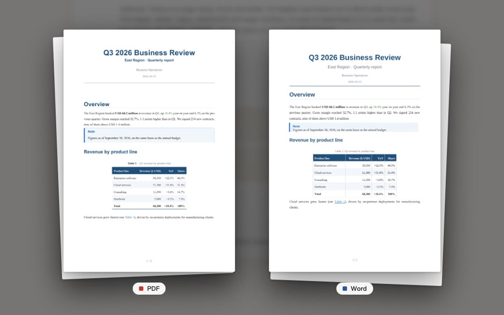
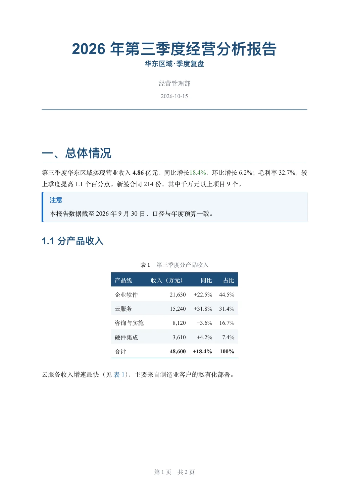
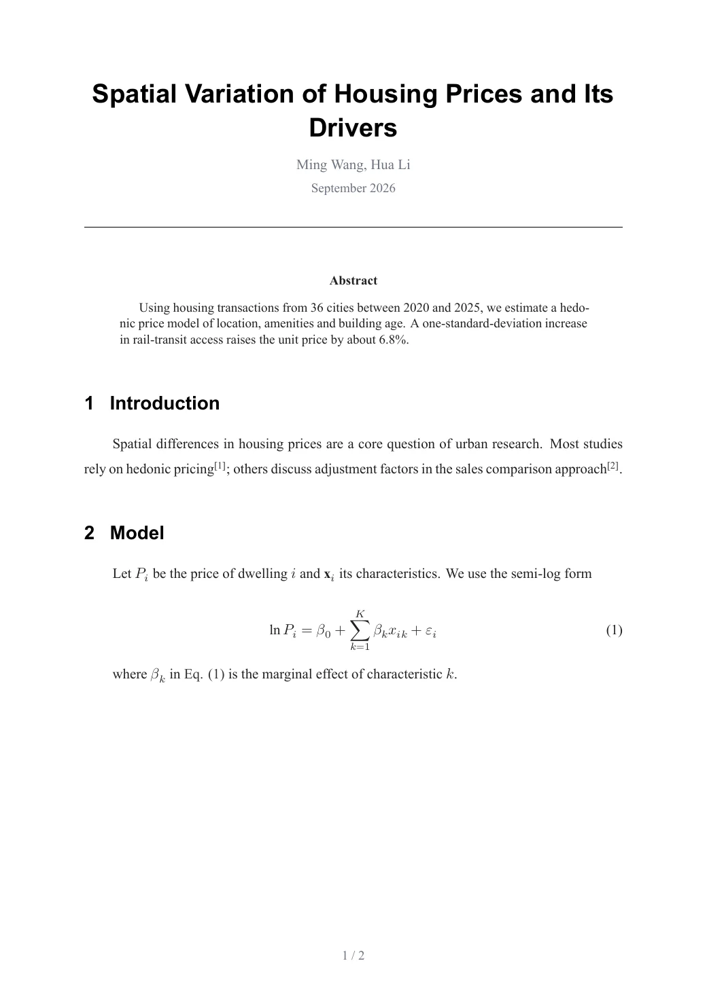
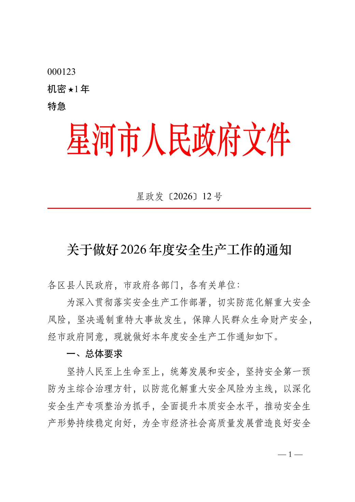
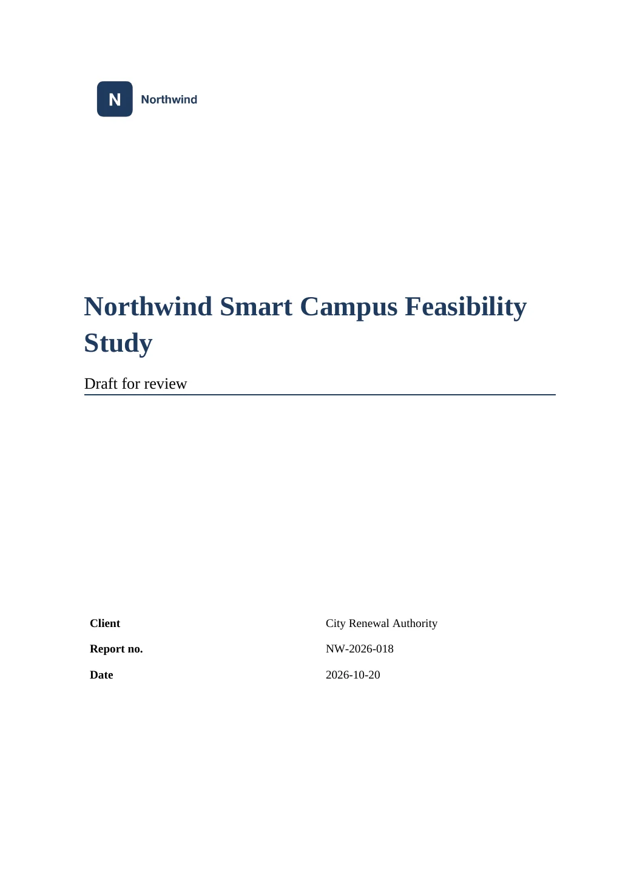
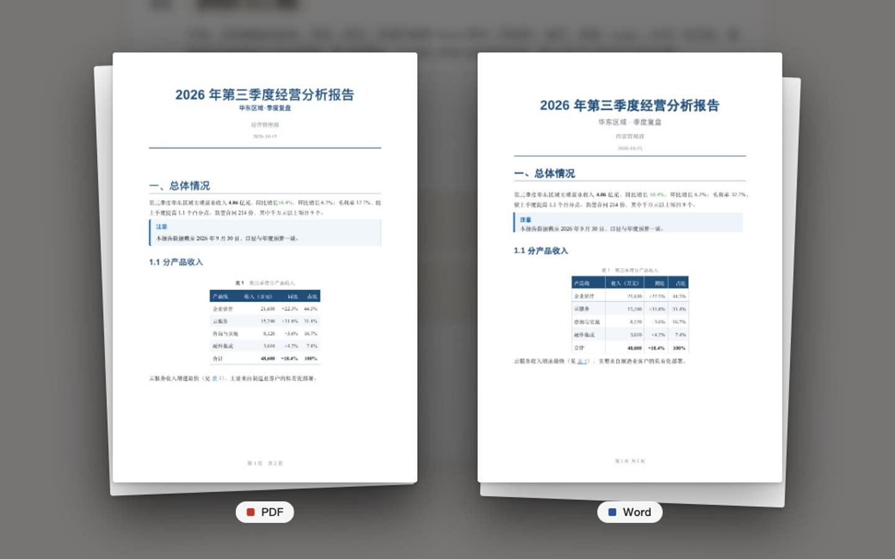

<div align="center">

# md-to-pdf-word

**Markdown → typeset PDF and editable Word. Word, LaTeX and PDF → back to clean Markdown.**
Free online, no sign-up. Correct Chinese text, merged table cells, numbered equations, references, cover pages.

### 👉 [mdpdfword.com](https://mdpdfword.com/)

[English](https://mdpdfword.com/) · [中文](https://mdpdfword.com/zh/) · [Français](https://mdpdfword.com/fr/) · [Deutsch](https://mdpdfword.com/de/) · [日本語](https://mdpdfword.com/ja/) · [Español](https://mdpdfword.com/es/)

<a href="https://mdpdfword.com/"></a>

</div>

## Try it in 10 seconds

1. Open **[mdpdfword.com](https://mdpdfword.com/)**.
2. Drop in a `.md`, `.docx`, `.tex` or `.pdf` file — or paste Markdown text.
3. Download the PDF and the Word file. Files are deleted automatically after 2 hours.

## What the results look like

Real output of the converter, unedited. More samples, with their Markdown source: **[Examples](https://mdpdfword.com/examples/)**.

<table>
<tr>
<td align="center" width="25%"><a href="https://mdpdfword.com/examples/report/"></a><br><b>Business report</b><br><sub>Tables, callouts, colors</sub></td>
<td align="center" width="25%"><a href="https://mdpdfword.com/examples/paper/"></a><br><b>Academic paper</b><br><sub>Numbered equations, citations</sub></td>
<td align="center" width="25%"><a href="https://mdpdfword.com/chinese-official-documents/"></a><br><b>Chinese official document</b><br><sub>GB/T 9704 red header</sub></td>
<td align="center" width="25%"><a href="https://mdpdfword.com/examples/template/"></a><br><b>Your company template</b><br><sub>Cover, logo, headers</sub></td>
</tr>
</table>

The business report above comes from plain Markdown like this:

```markdown
---
title: Q3 2026 Business Review
subtitle: East Region · Quarterly report
---

# Overview

The East Region booked **USD 68.2 million** in revenue in Q3, up [18.4%]{color=green} year on year.

> [!NOTE]
> Figures as of September 30, 2026, on the same basis as the annual budget.
```

## Converters

| | |
|---|---|
| [Markdown to PDF](https://mdpdfword.com/markdown-to-pdf/) | A typeset PDF with embedded fonts — no garbled Chinese, no broken tables |
| [Markdown to Word](https://mdpdfword.com/markdown-to-word/) | An editable .docx with real heading styles, table of contents, captions and editable equations |
| [PDF to Word](https://mdpdfword.com/pdf-to-word/) | Headings, lists, tables, pictures and colors restored into an editable Word file |
| [PDF to Markdown](https://mdpdfword.com/pdf-to-markdown/) | Well-structured Markdown with pictures as files — ready for AI tools, notes or a knowledge base |
| [Restyle a Word file](https://mdpdfword.com/word-template/) | Accept or reject all tracked changes and reformat a .docx consistently |
| [LaTeX to Word](https://mdpdfword.com/latex-to-word/) | A .tex project to Word, with equations, cross-references, figures and bibliography |
| [Chinese official documents](https://mdpdfword.com/chinese-official-documents/) | Red-header government documents laid out to GB/T 9704 |

- **Your own template:** upload a company Word template and the PDF and Word follow its fonts, margins, headers, footers, logo and cover.
- **Six styles:** Business, Modern, Academic, Elegant, Formal, Chinese official document.
- **Free, no sign-up.** Limits: 20 MB per file, 60 MB per upload, 30 conversions per hour.
- [Writing syntax](https://mdpdfword.com/syntax/) · [Guides](https://mdpdfword.com/guides/) · [FAQ](https://mdpdfword.com/faq/) · [Privacy](https://mdpdfword.com/privacy/)

## Use it from an AI assistant (MCP, no token)

Let Claude Code, Codex or Cursor save PDF and Word files for you:

```bash
# Claude Code
claude mcp add --transport http md-to-pdf-word https://mdpdfword.com/mcp -s user
```

```toml
# Codex: ~/.codex/config.toml
[mcp_servers.md-to-pdf-word]
url = "https://mdpdfword.com/mcp"
tool_timeout_sec = 300
```

Then ask: *“Convert report.md in this folder to PDF and Word.”* — [MCP guide](https://mdpdfword.com/mcp/)

## Use it from code (HTTP API, no key)

```bash
curl -F "file=@report.md" -F 'options={"formats":["pdf","docx"]}' \
  "https://mdpdfword.com/api/v1/jobs?wait=50"
```

The reply lists download links for each file. Python and other examples: [HTTP API](https://mdpdfword.com/http-api/).

## Feedback

This repository holds the public documentation and is where you can **report problems and suggest improvements**. The converter's source code is not published here.

- [Report a problem](../../issues/new?template=problem.yml) · [Suggest an improvement](../../issues/new?template=suggestion.yml)
- Or use **Feedback** on any page of the website.

---

## 中文简介

**Markdown 一键转成排版精美的 PDF 和可编辑的 Word；Word、LaTeX、PDF 也能转回干净的 Markdown。** 中文不乱码，支持合并单元格、公式编号、参考文献、封面、公司 Word 模板和党政机关公文（GB/T 9704）。免费、免注册，文件 2 小时后自动删除。

<a href="https://mdpdfword.com/zh/"></a>

- **网站：[mdpdfword.com/zh](https://mdpdfword.com/zh/)**　·　[示例](https://mdpdfword.com/zh/examples/)　·　[写法说明](https://mdpdfword.com/zh/syntax/)　·　[常见问题](https://mdpdfword.com/zh/faq/)
- **常用功能：** [Markdown 转 PDF](https://mdpdfword.com/zh/markdown-to-pdf/) · [Markdown 转 Word](https://mdpdfword.com/zh/markdown-to-word/) · [PDF 转 Word](https://mdpdfword.com/zh/pdf-to-word/) · [PDF 转 Markdown](https://mdpdfword.com/zh/pdf-to-markdown/) · [LaTeX 转 Word](https://mdpdfword.com/zh/latex-to-word/) · [党政机关公文](https://mdpdfword.com/zh/chinese-official-documents/)
- **给 AI 助手用（MCP，无需令牌）：** [mdpdfword.com/zh/mcp](https://mdpdfword.com/zh/mcp/)　·　**HTTP 接口（无需密钥）：** [mdpdfword.com/zh/http-api](https://mdpdfword.com/zh/http-api/)
- **反馈问题或建议：** 在本仓库 [提 issue](../../issues/new/choose)，或点击网站任意页面的“反馈”。
